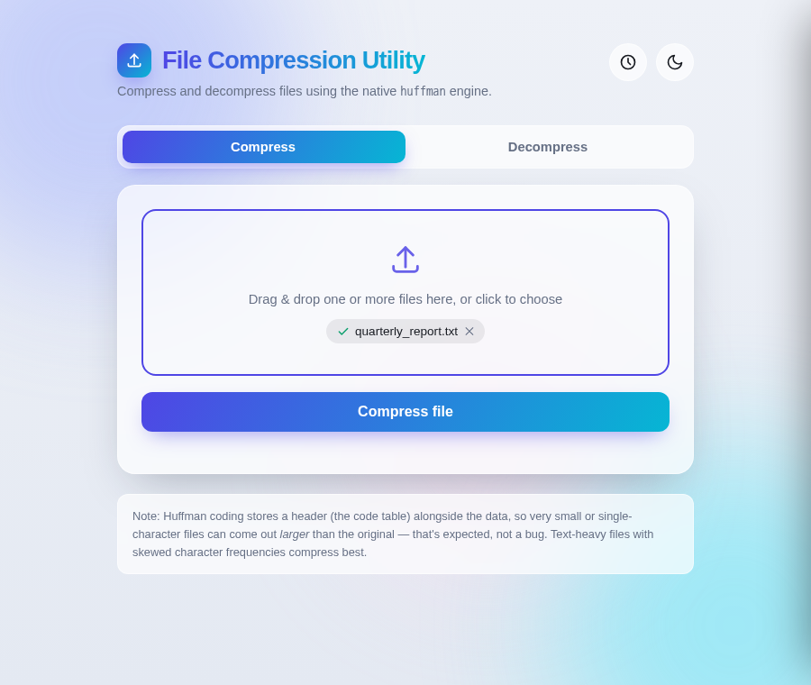
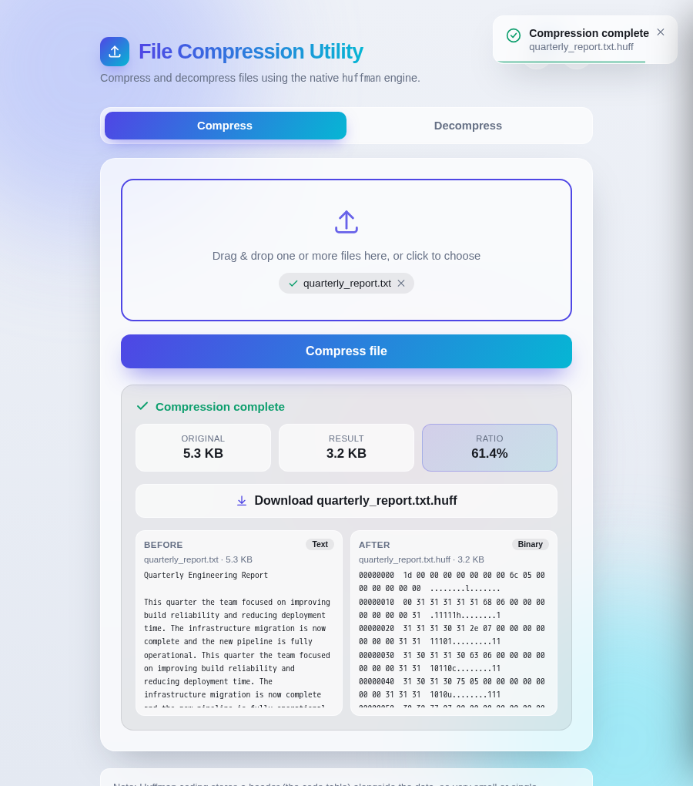
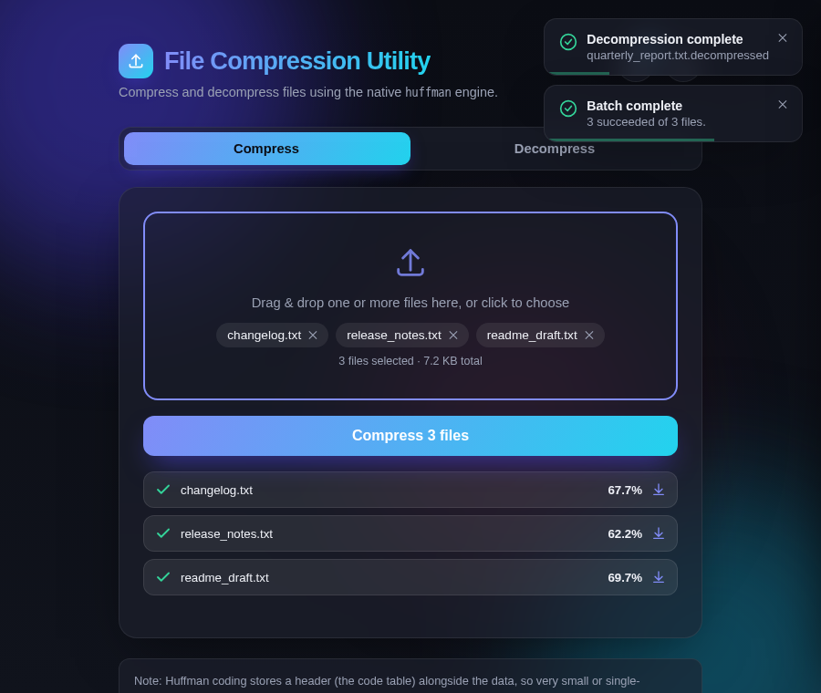
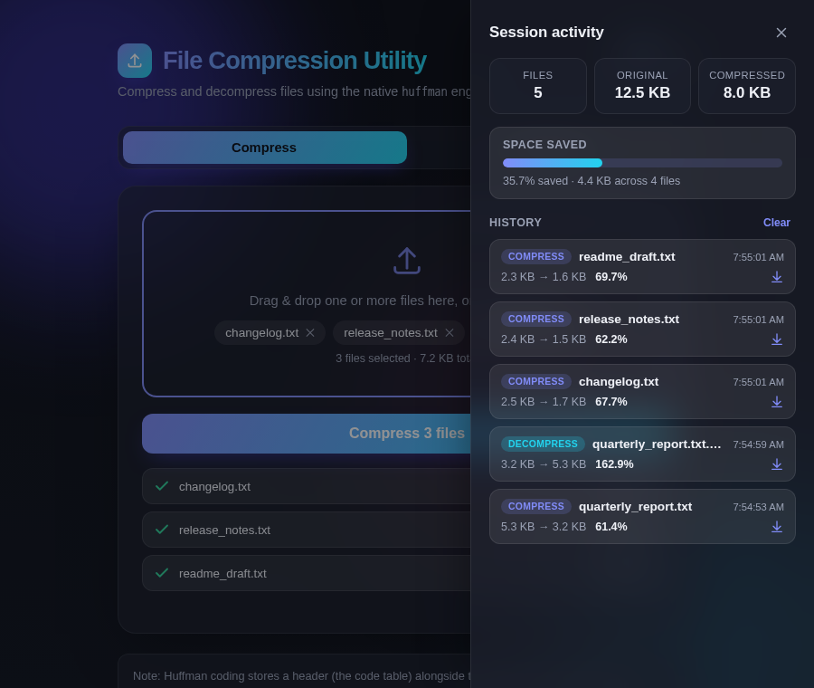

# File Compression Utility

A full-stack file compression tool built around a Huffman coding engine written from scratch in C++, wrapped in a modern Flask web application.

## Overview

This project pairs a native C++ compression core with a browser-based interface, so files can be compressed and decompressed either from the command line or through a polished web UI. The C++ binary does all the actual encoding/decoding work; the Flask layer is a thin, secure wrapper around it (subprocess calls, no shell interpolation) that adds uploads, downloads, and a richer user experience on top.

## Screenshots

| Compress (light theme) | Result + before/after preview |
|---|---|
|  |  |

| Dark theme + batch upload | Session history & analytics drawer |
|---|---|
|  |  |

## Features

- **C++ Huffman coding engine** — builds a frequency-based Huffman tree and encodes/decodes files at the bit level, exposed as a small standalone CLI binary.
- **Flask web interface** — drag-and-drop compress/decompress backed by the compiled engine, with real upload progress and error handling.
- **Batch file processing** — select and process multiple files in one go, with a live per-file progress and results list.
- **Session history** — a slide-out panel tracking every file compressed or decompressed in the current session, with one-click re-download.
- **Analytics dashboard** — aggregate stats (files processed, total size before/after, space saved) with a live progress meter.
- **Before/after preview** — side-by-side view of a file's content pre- and post-processing (readable text when possible, a hex dump for binary data).
- **Modern UI** — glassmorphism design with light/dark theme toggle, animated drag & drop, and toast notifications.

## Tech Stack

| Layer | Technology |
|---|---|
| Compression engine | C++ (STL `priority_queue`, `unordered_map`) |
| Backend | Python 3, Flask |
| Frontend | HTML5, CSS3 (glassmorphism/gradients), vanilla JavaScript |

## Project Structure

```
file-compression-utility/
├── huffman.cpp          # Core Huffman compression/decompression engine
├── app.py               # Flask backend — wraps the compiled binary
├── templates/
│   └── index.html       # Web UI (compress/decompress, history, previews)
├── requirements.txt     # Python dependencies
└── uploads/             # Per-request scratch space (auto-cleaned after each request)
```

## Getting Started

### Prerequisites

- A C++ compiler with C++17 support (`g++` recommended)
- Python 3.8+
- pip

### 1. Compile the C++ engine

```bash
g++ -O2 -std=c++17 -o huffman huffman.cpp
```

This produces a `huffman` executable in the project root, which `app.py` calls directly — it must exist before the web app will start.

### 2. Install Python dependencies

```bash
pip install -r requirements.txt
```

### 3. Run the web app

```bash
python3 app.py
```

Then open **http://localhost:5000** in your browser.

### Command-line usage (without the web UI)

The compiled binary also works standalone:

```bash
./huffman c <input_file> <output_file>   # compress
./huffman d <input_file> <output_file>   # decompress
```

## Notes

- Huffman coding stores its code table inside the compressed file, so very small or low-diversity inputs can come out *larger* than the original — this is expected overhead, not a bug.
- Files made up of a single repeated byte are a known edge case of the current tree-building logic and may not round-trip correctly.
